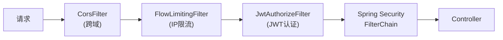
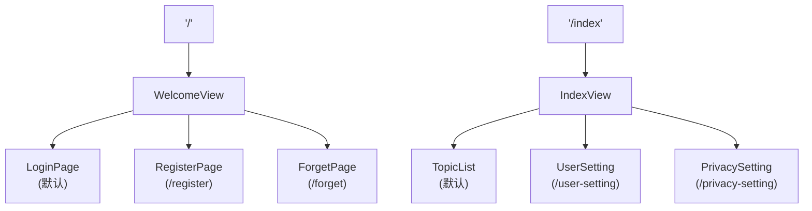
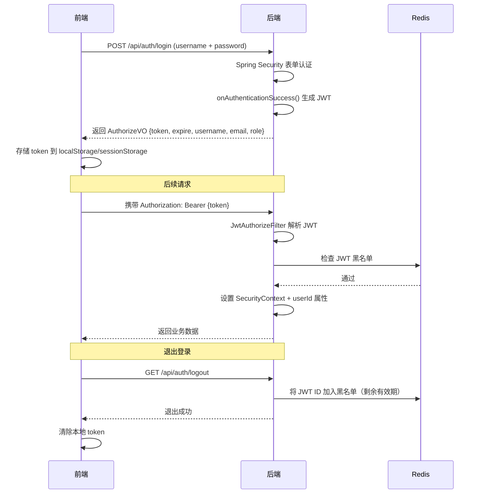

# 校园论坛项目架构分析

## 项目概述

这是一个基于 **Spring Boot 3 + Vue 3** 的前后端分离校园论坛模板项目，采用 **JWT** 进行身份认证，集成了多种企业级技术栈。

---

## 技术栈总览

| 层级 | 后端 (`my-project-backen`) | 前端 (`my-project-fronted`) |
|------|---------------------------|---------------------------|
| 框架 | Spring Boot 3.5.0 (Java 17) | Vue 3.5 + Vite 6 |
| 持久层 | MyBatis-Plus 3.5.12 | — |
| 数据库 | MySQL | — |
| 缓存 | Redis (端口 6385) | — |
| 消息队列 | RabbitMQ | — |
| 安全 | Spring Security + JWT (auth0) | Axios 拦截 + Token 管理 |
| 对象存储 | MinIO | — |
| UI 组件 | — | Element Plus 2.10 |
| 状态管理 | — | Pinia |
| 路由 | — | Vue Router 4 |
| 工具库 | Hutool 5.8 / Lombok / Fastjson2 | VueUse (暗色模式) |
| 富文本 | — | Vue Quill |
| 按需引入 | — | unplugin-auto-import |

---

## 后端架构

### 包结构

```
com.myproject
├── MyProjectBackenApplication.java   ← 启动类
├── config/                           ← 配置类
│   ├── SecurityConfiguration.java    ←── Spring Security + JWT 配置
│   ├── RabbitConfiguration.java      ←── RabbitMQ 队列配置
│   ├── MinioConfiguration.java       ←── MinIO 对象存储配置
│   └── WebConfiguration.java         ←── Web 相关配置
├── controller/                       ← 接口层
│   ├── AuthorizeController.java      ←── 认证：登录/注册/重置密码
│   ├── AccountController.java        ←── 用户管理：信息/详情/隐私/修改密码
│   ├── ForumController.java          ←── 论坛：天气/帖子类型
│   ├── ImageController.java          ←── 图片：头像/图片上传 (MinIO)
│   ├── IpController.java             ←── IP 相关
│   ├── ObjectController.java         ←── 对象存储
│   ├── TestController.java           ←── 测试接口
│   └── exception/                    ←── 全局异常处理
├── entity/                           ← 实体层
│   ├── BaseData.java                 ←── DTO→VO 反射转换接口
│   ├── RestBean.java                 ←── 统一 JSON 响应体 (record 类)
│   ├── dto/                          ←── 数据层对象
│   │   ├── Account.java              ←── 用户表 (db_account)
│   │   ├── AccountDetails.java       ←── 用户详情表
│   │   ├── AccountPrivacy.java       ←── 用户隐私设置表
│   │   └── StoreImage.java           ←── 图片存储表
│   └── vo/                           ←── 视图层对象
│       ├── request/                  ← 请求 VO（带 JSR303 校验）
│       │   ├── EmailRegisterVO        ← 邮箱注册
│       │   ├── EmailResetVO           ← 邮箱重置密码
│       │   ├── ConfirmResetVO         ← 确认重置
│       │   ├── ChangePasswordVO       ← 修改密码
│       │   ├── ModifyEmailVO          ← 修改邮箱
│       │   ├── DetailsSaveVO          ← 保存用户详情
│       │   └── PrivacySaveVO          ← 保存隐私设置
│       └── response/                 ← 响应 VO
│           ├── AuthorizeVO            ← 登录返回（含 token + expire）
│           ├── AccountVO              ← 用户基本信息
│           ├── AccountDetailsVO       ← 用户详情
│           ├── AccountPrivacyVO       ← 隐私设置
│           ├── TopicTypeVO            ← 帖子类型
│           └── WeatherVO              ← 天气信息
├── filter/                           ← 过滤器层
│   ├── CorsFilter.java              ←── 跨域处理过滤器
│   ├── JwtAuthorizeFilter.java       ←── JWT 认证过滤器
│   └── FlowLimitingFilter.java       ←── Redis IP 限流过滤器
├── listener/
│   └── MailQueueListener.java        ←── RabbitMQ 邮件发送监听器
├── mapper/                           ← MyBatis-Plus Mapper 层
│   ├── AccountMapper.java
│   ├── AccountDetailsMapper.java
│   ├── AccountPrivacyMapper.java
│   └── ImageServiceMapper.java
├── service/                          ← 业务逻辑层
│   ├── AccountService.java           ←── 用户服务 (含 UserDetailsService)
│   ├── AccountDetailsService.java
│   ├── AccountPrivacyService.java
│   ├── ImageService.java
│   ├── TopicService.java
│   ├── WeatherService.java
│   └── impl/                         ← 服务实现类
└── utils/                            ← 工具类
    ├── Const.java                    ←── 常量定义（Redis Key 前缀、角色等）
    ├── JwtUtils.java                 ←── JWT 创建/解析/验证/黑名单管理
    ├── FlowUtils.java                ←── Redis 限流计数工具
    └── ControllerUtils.java          ←── Controller 通用工具方法
```

### 核心设计模式

#### 1. 统一响应体 `RestBean<T>`
使用 Java 17 `record` 类实现，提供 `success()`、`failure()`、`onUnauthorized()`、`forbidden()` 等静态工厂方法，配合 Fastjson2 序列化为 JSON。

#### 2. DTO ↔ VO 自动转换 `BaseData`
利用 Java **反射** 实现同名字段自动拷贝，所有 DTO 只需实现 `BaseData` 接口即可调用 `asViewObject(VO.class)` 快速转换。

#### 3. 过滤器链



- **CorsFilter**：手动设置 CORS 响应头，允许跨域
- **FlowLimitingFilter**：基于 Redis 的 IP 限流（2秒50次，超限封禁30秒）
- **JwtAuthorizeFilter**：解析 JWT Token，设置 SecurityContext 和 userId 属性

---

## 前端架构

### 目录结构

```
src/
├── App.vue                    ← 根组件（暗色模式适配）
├── main.js                    ← 入口（baseURL: localhost:8080）
├── router/
│   └── index.js               ← 路由配置 + 导航守卫
├── net/
│   └── index.js               ← Axios 封装 + Token 管理
├── store/
│   └── index.js               ← Pinia 全局状态
├── components/
│   ├── Card.vue               ← 卡片组件
│   ├── LightCard.vue          ← 轻量卡片组件
│   ├── TopicEditor.vue        ← 帖子编辑器 (Quill 富文本)
│   └── Weather.vue            ← 天气组件
├── views/
│   ├── WelcomeView.vue        ← 欢迎页布局（未登录）
│   ├── welcome/
│   │   ├── LoginPage.vue      ← 登录页
│   │   ├── RegisterPage.vue   ← 注册页
│   │   └── ForgetPage.vue     ← 忘记密码页
│   ├── IndexView.vue          ← 主页布局（已登录）
│   ├── forum/
│   │   └── TopicList.vue      ← 帖子列表
│   └── settings/
│       ├── UserSetting.vue    ← 用户设置
│       └── PrivacySetting.vue ← 隐私设置
└── assets/                    ← 静态资源
```

### 路由设计



**导航守卫**：
- 已登录用户访问 `/welcome*` → 自动跳转 `/index`
- 未登录用户访问 `/index*` → 自动跳转 `/`

### 网络层封装 (`net/index.js`)

| 功能 | 说明 |
|------|------|
| `login()` | 表单登录，存储 token + expire 到 localStorage/sessionStorage |
| `logout()` | 调用后端注销接口，清除本地 token |
| `get()/post()` | 自动附带 `Bearer Token` 请求头 |
| `unauthorized()` | 判断是否未登录（token 不存在或已过期） |
| `accessHeader()` | 生成 Authorization 请求头 |

---

## 认证流程



---

## API 接口清单

### 认证模块 `/api/auth` (公开)
| 方法 | 路径 | 描述 |
|------|------|------|
| POST | `/login` | 用户登录 |
| GET  | `/logout` | 用户登出 |
| GET  | `/ask-code` | 请求邮件验证码 |
| POST | `/register` | 邮箱注册 |
| POST | `/reset-confirm` | 确认重置密码验证码 |
| POST | `/reset-password` | 重置密码 |

### 用户模块 `/api/user` (需认证)
| 方法 | 路径 | 描述 |
|------|------|------|
| GET  | `/info` | 获取用户基本信息 |
| GET  | `/details` | 获取用户详细信息 |
| POST | `/save-details` | 保存用户详情 |
| POST | `/modify-email` | 修改邮箱 |
| POST | `/change-password` | 修改密码 |
| POST | `/save-privacy` | 保存隐私设置 |
| GET  | `/privacy` | 获取隐私设置 |

### 论坛模块 `/api/forum` (需认证)
| 方法 | 路径 | 描述 |
|------|------|------|
| GET  | `/weather` | 获取天气信息 |
| GET  | `/types` | 获取帖子类型列表 |

### 图片模块 `/api/image` (需认证)
| 方法 | 路径 | 描述 |
|------|------|------|
| POST | `/cache` | 上传图片 (≤5MB) |
| POST | `/avatar` | 上传头像 (≤100KB) |

---

## 外部依赖服务

| 服务 | 用途 | 配置 |
|------|------|------|
| **MySQL** | 数据存储 | `localhost:3306/test` |
| **Redis** | JWT 黑名单 + IP 限流 + 验证码缓存 | `localhost:6385` |
| **RabbitMQ** | 异步邮件发送任务队列 | `localhost` (admin/admin123) |
| **MinIO** | 图片/头像对象存储 | `localhost:9000` |
| **163 邮箱 SMTP** | 发送验证码邮件 | `smtp.163.com` |
| **和风天气 API** | 天气信息查询 | API Key 配置在 yml |
